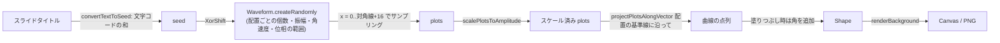
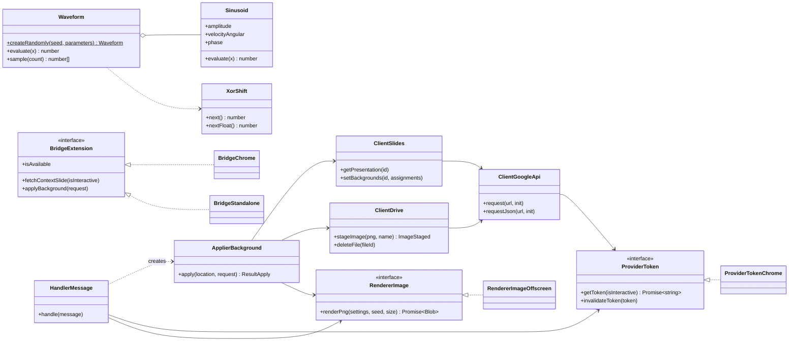
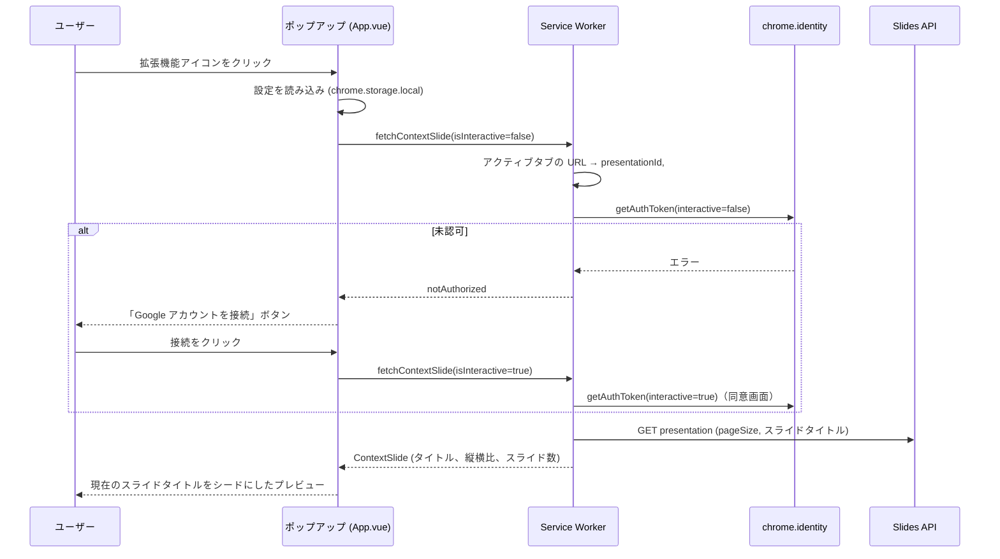
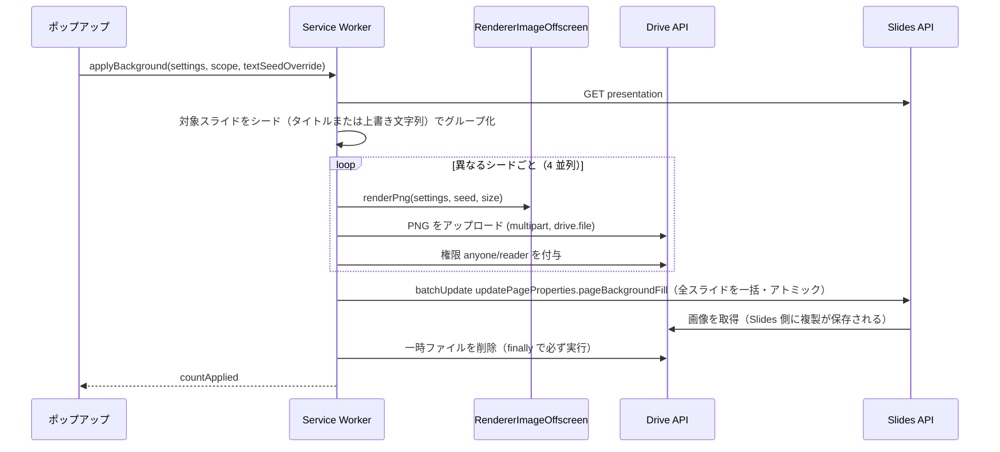

# アーキテクチャ

[English](Architecture.md)

## 概要

Manifest V3 の Chrome 拡張機能で、2 つの実行コンテキストがあります。

| コンテキスト         | エントリ                          | 役割                                                                 |
| -------------------- | --------------------------------- | -------------------------------------------------------------------- |
| ポップアップ (Vue 3) | `Src/Popup/Main.ts` → `App.vue`   | UI、ライブプレビュー、設定の保存、コピー/ダウンロード                |
| Service Worker       | `Src/Background/ServiceWorker.ts` | OAuth、アクティブな Slides タブの読み取り、Google API 呼び出し、適用 |

両者は `Src/Core` の純粋な描画コードを共有します。時間のかかる API 処理は Service Worker で実行します。これにより、OAuth 同意画面などでポップアップが閉じても処理が途切れません。

```text
Src/
  Core/        SinDrawer から移植した純粋なアルゴリズム（DOM・chrome.* 非依存）
  Slides/      Google Slides / Drive 連携（Core に依存、トークン提供元は注入）
  Background/  Service Worker: コンポジションルート、chrome.identity、メッセージ振り分け
  Shared/      メッセージ契約、エラー型、OffscreenCanvas レンダラ
  Popup/       Vue ポップアップ: App.vue、Components/、Services/、Models/、Styles/
BuildTools/    vite.config.ts が使う manifest 生成
Public/        そのままコピーされる静的ファイル: _locales/、Icons/
Scripts/       開発用スクリプト（アイコン生成）
Tests/         Src/ と同じ構成の Vitest ユニットテスト
```

## 描画アルゴリズム (`Src/Core`)

オリジナルの `main.js` の `Draw()` を再現しています。`Tests/Core/Curve.test.ts` でオリジナルのコピーと頂点単位で比較しています。



- **配置プリセット** (`Placement.ts`) はオリジナルの定数をそのまま保持しています（乱数の範囲、基準線の始点と方向、閉じるための角、軸位置の既定値）。
- **解像度非依存**: 形状は幅 1280 px（オリジナルの既定幅）の論理座標で作り、高さはスライドの縦横比から決めます。`renderBackground` がこれを出力幅に合わせて拡大します。出力解像度を変えても見た目は変わらず、精細になるだけです。
- **線幅**: オリジナルは HotSoupScript の `DrawLine` に `3` を渡していますが、`ctx.line_width`（綴り違い）を設定しているため、実際の描画は 1 px です。移植版も出力を合わせるため 1 px で描きます。
- **完全一致**: ノルム計算は `Math.hypot` ではなく `(x ** 2 + y ** 2) ** 0.5` を使い、浮動小数点の結果までオリジナルと一致させています。

## クラス図



設計上のポイント:

- **依存性逆転**: `Slides/` のコードは `chrome.*` ではなく `ProviderToken` と `RendererImage` インターフェースに依存します。Service Worker が具体クラスを組み立て、テストではフェイクを注入します。
- **ブリッジ**: ポップアップは `BridgeExtension` を通してのみ Service Worker にアクセスします。`BridgeStandalone` を使うと、UI デバッグ用にポップアップを普通の Web ページとして動かせます（`pnpm dev`）。
- **設定のサニタイズ**: ストレージから読んだ値やメッセージで受け取った値は、すべて `normalizeSettings` / `normalizePreferences` を通します。

## シーケンス: ポップアップを開く



## シーケンス: 背景を適用する



アップロードが 1 つでも失敗した場合、残りのアップロードは完了を待ち（`Promise.allSettled`）、作成したファイルはすべて削除します。公開状態のファイルは残りません。

## ビルド

`vite.config.ts` は、ポップアップ HTML とモジュール形式の Service Worker を 1 回の Rollup ビルドで生成します。`sindrawer-manifest` プラグインが `BuildTools/ManifestBuilder.ts` から `dist/manifest.json` を生成し、次の値を埋め込みます。

- `version`: `package.json` から
- `oauth2.client_id`: `.env` の `GOOGLE_OAUTH_CLIENT_ID` から（未設定ならプレースホルダーになり、ポップアップに設定方法が表示されます）
- `key`: 任意の `EXTENSION_KEY` から

## ローカライズ

`Public/_locales/{en,ja}/messages.json` が UI テキストの唯一の定義元です。Chrome は拡張機能の名前と説明に、これらのファイルを使います。ポップアップは `Translator` で両方のファイルをバンドルしており、拡張機能を再読み込みせずに言語を切り替えられます。`Tests/Popup/Translator.test.ts` で両カタログのキーが一致することを確認しています。
