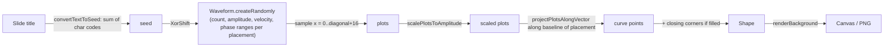
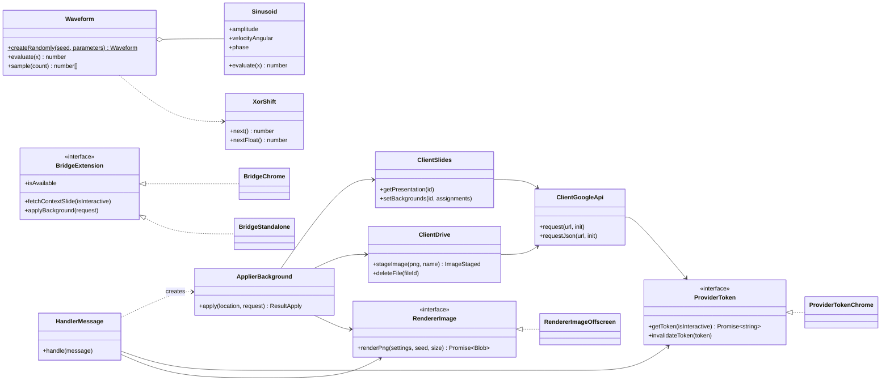
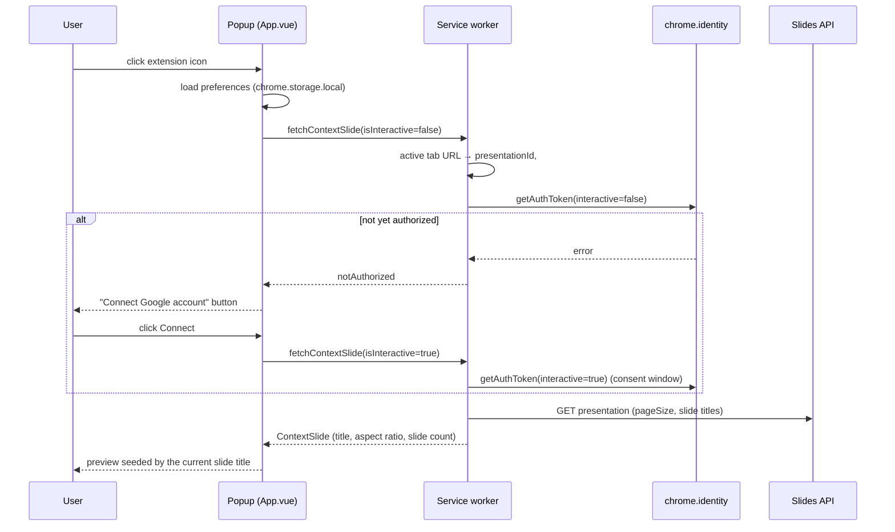
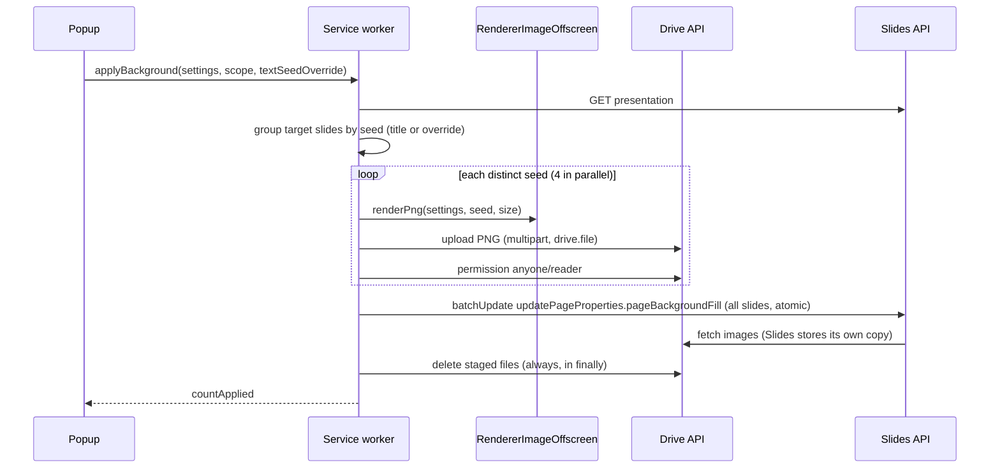

# Architecture

[日本語版](Architecture.ja.md)

## Overview

The extension is a Manifest V3 Chrome extension with two runtime contexts:

| Context        | Entry                             | Responsibility                                                   |
| -------------- | --------------------------------- | ---------------------------------------------------------------- |
| Popup (Vue 3)  | `Src/Popup/Main.ts` → `App.vue`   | UI, live preview, preferences, copy/download                     |
| Service worker | `Src/Background/ServiceWorker.ts` | OAuth, reading the active Slides tab, Google API calls, applying |

Both contexts share the pure drawing code in `Src/Core`. Long API work runs in the service worker so it is not cut off if the popup closes, for example during the OAuth consent window.

```text
Src/
  Core/        Pure algorithm ported from SinDrawer (no DOM, no chrome.*)
  Slides/      Google Slides / Drive integration (depends on Core, injected token provider)
  Background/  Service worker: composition root, chrome.identity, message dispatch
  Shared/      Message contract, error type, OffscreenCanvas renderer
  Popup/       Vue popup: App.vue, Components/, Services/, Models/, Styles/
BuildTools/    Manifest generation used by vite.config.ts
Public/        Static files copied as-is: _locales/, Icons/
Scripts/       Dev scripts (icon generator)
Tests/         Vitest unit tests mirroring Src/
```

## Drawing algorithm (`Src/Core`)

The pipeline reproduces the original `main.js` `Draw()`. `Tests/Core/Curve.test.ts` compares it vertex-for-vertex with a verbatim copy of the original.



- **Placement presets** (`Placement.ts`) hold the original constants: random ranges, baseline start and direction, closing corners, and the default axis position.
- **Resolution independence**: the shape is built in a logical space 1280 px wide (the original default width), with the height taken from the slide aspect ratio. `renderBackground` then scales it to the output width. Changing the output resolution makes the image sharper without changing how it looks.
- **Line width**: the original passes `3` to HotSoupScript's `DrawLine`, but that sets a misspelled `ctx.line_width`, so 1 px is what is actually drawn. The port draws 1 px to match the original output.
- **Exactness**: the norm uses `(x ** 2 + y ** 2) ** 0.5` rather than `Math.hypot`, so floating-point results are bit-identical.

## Class diagram



Design notes:

- **Dependency inversion**: `Slides/` code depends on the `ProviderToken` and `RendererImage` interfaces, not on `chrome.*`. The service worker wires in the concrete classes, and tests inject fakes.
- **Bridge**: the popup reaches the service worker only through `BridgeExtension`. `BridgeStandalone` makes the popup run as a plain web page (`pnpm dev`) for UI debugging.
- **Settings sanitization**: everything read from storage or received in messages goes through `normalizeSettings` / `normalizePreferences`.

## Sequence: opening the popup



## Sequence: applying a background



If any upload fails, the remaining uploads are allowed to finish (`Promise.allSettled`) and every staged file is deleted, so no public file is left behind.

## Build

`vite.config.ts` builds the popup HTML and the module service worker in one Rollup build. The `sindrawer-manifest` plugin generates `dist/manifest.json` from `BuildTools/ManifestBuilder.ts`, injecting:

- `version` from `package.json`
- `oauth2.client_id` from `GOOGLE_OAUTH_CLIENT_ID` in `.env` (a placeholder if missing; the popup then shows a setup hint)
- `key` from the optional `EXTENSION_KEY`

## Localization

`Public/_locales/{en,ja}/messages.json` are the single source of text. Chrome uses them for the extension name and description. The popup bundles both files through `Translator`, so the language can be switched at runtime without reloading the extension. `Tests/Popup/Translator.test.ts` makes sure both catalogs have the same keys.
